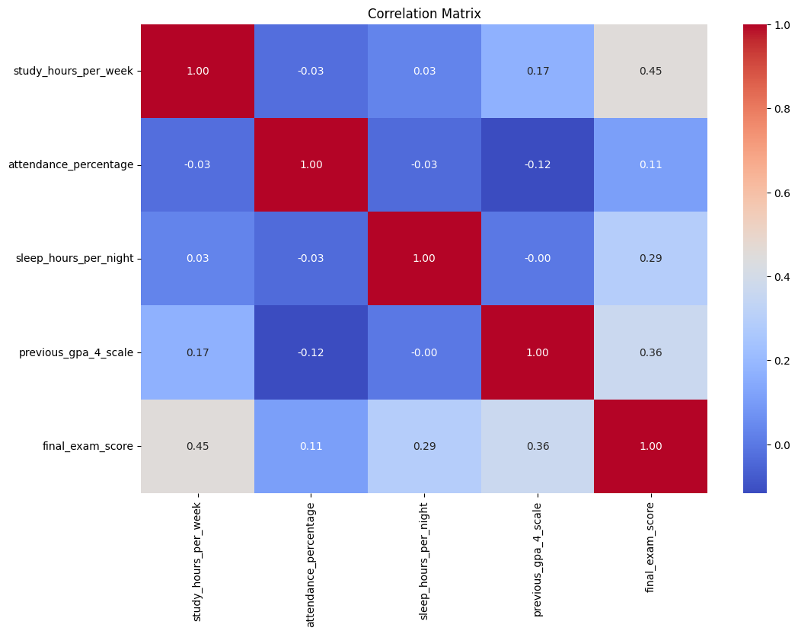

# Statistical Analysis of Student Academic Performance

# Objectives
1. Calculate the average examination score.
2. Measure the variation in students' examination scores.
3. Examine the relationship between study hours and examination marks.
4. Predict examination marks using study hours.


# The project includes:
- Descriptive statistics
- Pearson correlation analysis
- Independent-samples t-test
- Multiple linear regression
- Hypothesis testing
- Grade distribution
- Statistical interpretations and recommendations


# Interpretation of Descriptive Statistics

A. study_hours_per_week
 # 12.19 hours

Average weekly study time:
- Mean: 12.19
- Median: 12.0
- Mode: 10.6
- Standard Deviation: 3.68
- Variance: 13.51
- Minimum: 2.7
- Maximum: 20.7

# Interpretation:
Students study approximately 12.19 hours per week on average. The mean and median are very close, indicating a relatively balanced distribution. The standard deviation of 3.68 indicates moderate variation in students' weekly study time.


B. Attendance Percentage

# 78.13%

Average attendance:
- Mean: 78.13%
- Median: 78.6%
- Mode: 100.0%
- Standard Deviation: 11.12%
- Variance: 123.58%
- Minimum: 48.6%
- Maximum: 100.0%

# Interpretation:
The average student attendance is approximately 78%. The standard deviation of 11.12 percentage points indicates noticeable variation in attendance among students. Some students have very high attendance, while others have relatively low attendance.

C. Sleep Hours per Night

# 6.63 hours

Average nightly sleep duration:
Mean: 6.63
Median: 6.5
Mode: 6.4
Standard Deviation: 0.96
Variance: 0.92
Minimum: 4.4
Maximum: 9.3

# Interpretation:
Students sleep approximately 6.63 hours per night on average. The standard deviation of 0.96 indicates relatively low variation in sleeping hours. Most students have sleep durations reasonably close to the average.

D. Previous GPA (4.00 Scale)

# 2.98 / 4.00

Average previous GPA:
- Mean: 2.98
- Median: 3.02
- Mode: 2.72
- Standard Deviation: 0.43
- Variance: 0.18
- Minimum: 1.86
- Maximum: 4.0

# Interpretation:
The average previous GPA is approximately 2.98 out of 4.00. The mean and median are almost identical, indicating a relatively symmetric distribution. The standard deviation of 0.43 suggests moderate variation in previous academic performance.


E. Final Exam Score

# 90.98

Average final examination score:
- Mean: 90.98
- Median: 91.60
- Mode: 100.0
- Standard Deviation: 7.89
- Variance: 62.27
- Minimum: 67.3
- Maximum: 100.0

# Interpretation:
The average final examination score is 90.98, indicating generally high scores in the dataset. The median of 91.60 is slightly higher than the mean. The standard deviation of 7.89 indicates some variation in examination performance.

# Categorical Descriptive Statistics
For categorical variables, we use frequency counts, percentages, and mode instead of mean and standard deviation.

A. Internet Access

```bash
    Category	Frequency	Percentage
        Yes     	155	       80.31%
        No	         40    	   19.69%
      Total	        195	        100%
```

# Interpretation: 
80.31% of students have internet access, while 19.69% do not. This indicates that most students have access to internet facilities.

B. Extracurricular Participation

```bash
    Category	Frequency	Percentage
        No       	68	       35.23%
        Yes	        125    	   64.77%
      Total	        193	        100%
```

# Interpretation: 
 Approximately 35.23% of students participate in extracurricular activities, whereas 64.77% do not. Most students in this dataset do not participate in extracurricular activities.

C. Grade Distribution

```bash
       Grade	  Frequency	        Percentage
        A            172	          89.12%
        B             19               9.84%
        C              2    	       1.04%
       Total	     193	            100%
```
# Interpretation: 
Grade A is the most frequent category, representing 89.12% of students. Only 1.04% received Grade C. This indicates a highly concentrated grade distribution.

# Range and Interquartile Range (IQR) Analysis:
Range measures the difference between maximum and minimum values.
IQR measures the spread of the middle 50% of observations.
```
                                    Range = Maximum - Minimum
                                    IQR=Q3-Q1
                                    Lower Bound = Q1-1.5(IQR)
                                    Upper Bound = Q3+1.5(IQR)
                                    X < Lower Bound
                                    X > Upper Bound

```

```
    Variable	                    Range	         IQR
    study_hours_per_week	        23.00	         4.82
    attendance_percentage	        53.80	        15.53
    sleep_hours_per_night	        5.60	         1.33
    previous_gpa_4_scale	        2.14	         0.57 
    final_exam_score 	            32.70	        13.12
```

```IQR Analysis:
                          Q1     Q3    IQR  Lower Bound  Upper Bound
study_hours_per_week    9.88  14.70   4.82         2.64        21.94
attendance_percentage  70.00  85.52  15.53        46.71       108.81
sleep_hours_per_night   6.00   7.32   1.33         4.01         9.31
previous_gpa_4_scale    2.70   3.27   0.57         1.85         4.12
final_exam_score       85.60  98.72  13.12        65.91       118.41
```

# Interpretation:
 - Attendance has the largest range, showing considerable differences in attendance percentages.
 - Study hours have an IQR of 4.82, meaning the middle 50% of students study within a relatively narrow interval.
 - Sleep hours have a relatively small IQR, suggesting that most students have similar sleep durations.
 - Final exam scores have an IQR of 13.12, indicating some variation in the middle 50% of scores.


# Overall Statistical Findings
Key findings from descriptive analysis
- Academic performance: Average final exam score is 90.98.
- Study habits: Students study approximately 12.19 hours per week.
- Attendance: Average attendance is 78.13%.
- Sleep pattern: Average sleeping duration is 6.63 hours.
- Previous academic performance: Average GPA is 2.98.
- Internet access: 80.31% of students have internet access.
- Grade distribution: 89.12% of students achieved Grade A.
- Data quality: No missing values were found.

# Statistical Interpretation of Correlation Matrix:

A. Study Hours vs Final Exam Score
r = 0.453 · Moderate positive
- Correlation coefficient = 0.453.
- Students who study more hours tend to achieve higher examination scores.
- This is the strongest individual numerical correlation with final exam score in your dataset.
Finding: Study hours have a moderate positive relationship with academic performance.

# Finding: 
Study hours have a moderate positive relationship with academic performance.

B. Attendance vs Final Exam Score
r = 0.108 · Very weak positive
- Correlation coefficient = 0.108.
- Attendance has a very weak positive linear relationship with examination scores.
- The relationship is not statistically significant at the 5% level (p = 0.169).
# Finding: 
Attendance does not show a statistically significant linear association with final exam scores in this sample.

C. Sleep Hours vs Final Exam Score
r = 0.292 · Weak positive
- Correlation coefficient = 0.292.
- Students with longer sleep durations tend to have higher examination scores.
- The relationship is statistically significant (p less than 0.001).
# Finding:
Sleep duration has a weak positive relationship with academic performance.

D. Previous GPA vs Final Exam Score
r = 0.365 · Weak positive
- Correlation coefficient = 0.365.
- Students with higher previous GPA tend to achieve higher final examination scores.
- The relationship is statistically significant (p less than 0.001).
# Finding:
Previous GPA has a positive relationship with final examination performance.

# Correlation with Statistical Significance

We can use the Pearson correlation test to determine whether the observed correlations are statistically significant.

Hypotheses:
- H₀: There is no linear correlation between the two variables in the population (ρ=0).
- H₁: There is a linear correlation between the two variables in the population (ρ≠0).

```
                Variable  Correlation  P-value Significant
0   study_hours_per_week       0.4515    0.000         Yes
1  attendance_percentage       0.0976    0.169          No
2  sleep_hours_per_night       0.3001    0.000         Yes
3   previous_gpa_4_scale       0.3665    0.000         Yes
```



# Interpretation: 
At the 5% significance level, study hours, sleep hours, and previous GPA have statistically significant positive linear correlations with final exam scores. Attendance does not.


## Clone Repository

```bash
git clone https://github.com/arfinmahmudshiblu/Statistical-Data-Analysis-Project.git
```

```bash
conda create -n webapp python=3.12 -y
```

```bash
conda activate webapp 
```

```bash
pip install -r requirements.txt
```


 